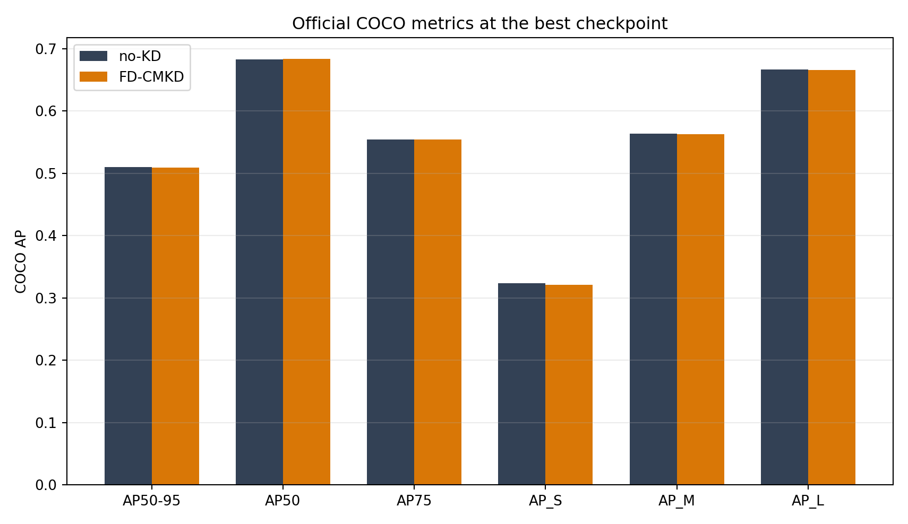

# YOLOv12 FD-CMKD Reproduction

[한국어 요약](#한국어-요약) · [Method](docs/methodology.md) · [Results](docs/results.md) · [Follow-up experiments](docs/follow-up-experiments.md)

> [!IMPORTANT]
> This is an **unofficial research fork** of
> [VIPLAB-Gachon/YOLOv12-Distillation](https://github.com/VIPLAB-Gachon/YOLOv12-Distillation).
> It evaluates an experimental `sample_sum` FD loss variant. It is neither an origin-strict
> reproduction nor a paper-faithful implementation of FD-CMKD.

## Current status

The exact upstream `mean` implementation has now also been evaluated in an origin-strict seed-0
comparison. Batch 16 was not feasible for the FD arm on the 16 GB test GPU, so the prespecified
fairness fallback restarted **both** arms from the same checkpoint at batch 12 for 50 epochs.

| Origin-strict arm | Official COCO best AP50-95 | Last-5 mean |
|---|---:|---:|
| no-KD | 0.509662 | 0.509530 |
| FD-CMKD upstream `mean` | 0.509905 | 0.509434 |
| Difference | **+0.000244** | **-0.000096** |

The seed-0 gate required at least `+0.001` official best AP50-95 and a positive last-five-epoch
delta. It failed, so seeds 1-2 were not run. The highest-priority follow-up—testing a
scale-normalized reduction while holding the mask and other settings fixed—is **in progress**.
See the [origin-strict record](experiments/origin_strict/README.md) and
[experiment roadmap](docs/follow-up-experiments.md).

## Earlier sample-sum finding

The original implementation L2-normalizes each `C x H x W` feature tensor and then applies
mean-reduced MSE. A no-step gradient probe found that the effective FD feature contribution was
about `3.48e-7` of the detection loss, with a combined FD/detection gradient RMS ratio of
`2.20e-8`. The feature path existed and produced finite values, but its training signal was
negligible under the tested configuration.

This fork adds an opt-in `sample_sum` reduction:

```python
# Original
F.mse_loss(student, teacher)

# Experimental variant
(student - teacher).square().flatten(1).sum(1).mean()
```

`sample_sum` made the FD gradients measurable and passed the predefined signal gate. However, in
the controlled seed-0 comparison it did **not** improve COCO AP over a no-KD control.

| Arm | Official COCO best AP50-95 | AP50 | AP75 | Runtime |
|---|---:|---:|---:|---:|
| no-KD | 0.509587 | 0.682849 | 0.553995 | 23.41 h |
| FD-CMKD `sample_sum` | 0.509225 | 0.683365 | 0.554096 | 49.12 h |
| Difference | **-0.000362** | +0.000516 | +0.000101 | +25.71 h |

The last-three-epoch AP50-95 difference was `-0.000137`. Only seed 0 was completed, so this is
evidence of **no observed gain**, not proof that the expected effect is exactly zero.



## Why `sample_sum` was tested

For the aligned feature shapes in this experiment, replacing an element mean with a per-sample
sum changes the loss scale by exactly the number of feature elements:

| Level | Shape | `sample_sum / mean` |
|---|---:|---:|
| P3 | `384 x 80 x 80` | 2,457,600x |
| P4 | `768 x 40 x 40` | 1,228,800x |
| P5 | `768 x 20 x 20` | 307,200x |

This is intentionally a diagnostic intervention, not a small numerical correction. It changes
the objective and changes the relative scaling of pyramid levels. Results from this branch must
not be reported as results from the upstream implementation.

## What changed

- `YOLO_FD_REDUCTION=mean` preserves upstream behavior and remains the default.
- `YOLO_FD_REDUCTION=sample_sum` enables the experimental reduction.
- Per-level low/high/raw/effective FD losses can be captured for diagnostics.
- Live graph tensors are retained only when `YOLO_FD_CAPTURE_PROBE=1`.
- Included experiment artifacts contain the configs, hashes, official COCO metrics, signal probes,
  and figures needed to audit the reported result.

## Experiment scope

The controlled comparison used:

- COCO 2017, image size 640
- YOLOv12-X teacher and YOLOv12-M student
- identical baseline-derived starting checkpoint for both arms
- 45 total epochs, batch 12, seed 0, deterministic mode, AMP
- SGD, `lr0=0.0005`, momentum 0.9, warmup 0
- FD arm only: `sample_sum`, feature KD weight 0.1, head KD weight 0.2

Training continued from separately materialized stage-15 checkpoints with equivalent provenance.
This differs from the upstream README recipe (`50` epochs, batch `16`, default optimizer/LR,
original `mean` reduction).

## Reproduction entry points

Set up the upstream dependencies and provide COCO plus the YOLOv12-M/X checkpoints as described by
the original project. The reduction is selected through an environment variable:

```bash
export YOLO_FD_REDUCTION=sample_sum
export YOLO_FD_CAPTURE_PROBE=0
```

Use the archived configs in [`experiments/configs`](experiments/configs) as an exact record of the
completed run. Checkpoint and dataset paths are placeholders and must be adapted locally.

Run the focused reduction tests with:

```bash
python3 -m unittest tests.test_fd_sample_sum
```

## Repository guide

- [`docs/methodology.md`](docs/methodology.md): equations, signal probe, and experimental design
- [`docs/results.md`](docs/results.md): COCO/TIDE results and interpretation boundaries
- [`docs/original-vs-current.md`](docs/original-vs-current.md): upstream, paper, and fork differences
- [`docs/follow-up-experiments.md`](docs/follow-up-experiments.md): prioritized remaining experiments
- [`experiments/configs`](experiments/configs): archived training arguments
- [`experiments/results`](experiments/results): machine-readable evidence
- [`experiments/figures`](experiments/figures): result and diagnostic figures
- [`NOTICE.md`](NOTICE.md): provenance, attribution, and licensing notes

## Known limitations

- One seed only; the observed delta is too small for a robust statistical conclusion.
- This is not an origin-strict run and does not establish the performance of upstream `mean` at
  the exact README settings.
- The upstream frequency mask is not vertically conjugate-symmetric for `rfft2`; this fork records
  the issue but does not change the mask.
- Upstream FD-CMKD is a same-modal YOLO feature-map adaptation and differs substantially from the
  cross-modal, feature-vector formulation in the referenced paper.
- Checkpoints and COCO predictions are excluded because of size. Their SHA-256 hashes are retained.

## 한국어 요약

원본 FD loss는 전체 feature를 unit L2 normalization한 뒤 `C x H x W` 원소 평균 MSE를 다시
적용하여, 측정된 FD gradient가 detection gradient 대비 사실상 무시할 수 있는 수준이었습니다.
이를 진단하기 위해 원소 합 기반 `sample_sum`을 선택적으로 추가했습니다. FD 신호는 충분히
커졌지만, 동일 시작점과 설정의 seed 0 비교에서 no-KD 대비 공식 COCO AP50-95가
`0.000362` 낮았습니다. 따라서 현재 결론은 **기능 신호는 복구됐지만 성능 향상은 재현되지
않았다**입니다. 후속 실험은 [로드맵](docs/follow-up-experiments.md)에 우선순위별로 정리했습니다.

추가로 원본 commit과 원본 `mean` reduction을 유지한 50-epoch 비교를 수행했습니다. batch 16
OOM 이후 두 arm을 동일 시작점의 batch 12로 공정하게 재시작했습니다. 공식 best AP50-95 차이는
`+0.000244`였지만 마지막 5 epoch 평균 차이는 `-0.000096`이어서 사전 성능 게이트를 통과하지
못했습니다. 현재는 feature KD의 극단적인 축소를 직접 겨냥한 **scale-normalized reduction
단독 실험을 진행 중**입니다.

## License

The upstream project and this fork are distributed under the GNU Affero General Public License
v3.0. See [`LICENSE`](LICENSE) and [`NOTICE.md`](NOTICE.md).
