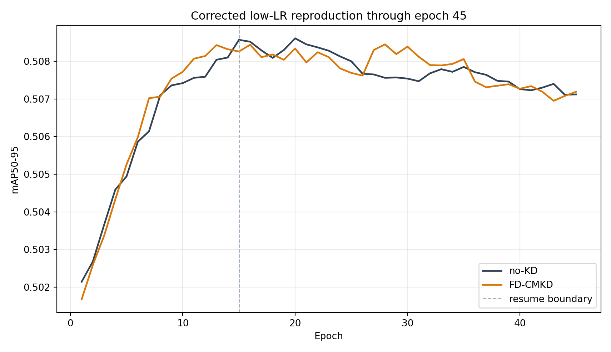

# Results

## Origin-strict baseline (completed)

The clean upstream commit `548f2e2` was evaluated with the original `mean` reduction, frequency
mask, and KD weights. The no-KD and FD-CMKD arms used the same starting checkpoint, seed, data
order, augmentation, optimizer policy, learning-rate schedule, and evaluator. FD-CMKD ran out of
memory at batch 16 on the RTX 5080 16 GB GPU. Following the prespecified fallback, both arms were
restarted from the same baseline at batch 12 and trained for 50 epochs.

| Metric | no-KD | Origin FD-CMKD | Delta |
|---|---:|---:|---:|
| Official best AP50-95 | 0.509662 | 0.509905 | +0.000244 |
| AP50 | 0.681031 | 0.680987 | -0.000044 |
| AP75 | 0.556566 | 0.555429 | -0.001137 |
| AP Small | 0.326668 | 0.327255 | +0.000588 |
| AP Medium | 0.564727 | 0.563854 | -0.000873 |
| AP Large | 0.676247 | 0.677651 | +0.001404 |
| Last-five-epoch AP50-95 mean | 0.509530 | 0.509434 | -0.000096 |

The predefined gate required an official best delta of at least `+0.001` and a positive
last-five-epoch delta. Neither condition passed; additional seeds were therefore skipped.

The zero-weight path matched no-KD exactly for loss, 405 parameter gradients, and the one-step
update. The origin probe was finite and non-zero, but the median combined feature/detection
gradient ratio was approximately `4.33e-9`. This makes a wiring failure unlikely and supports the
hypothesis that the upstream reduction suppresses the feature-KD optimization signal.

Machine-readable evidence is archived under
[`experiments/origin_strict`](../experiments/origin_strict/README.md).

## Earlier sample-sum result

| Checkpoint | no-KD AP50-95 | FD `sample_sum` AP50-95 | Delta |
|---|---:|---:|---:|
| Last | 0.507141 | 0.507415 | +0.000274 |
| Best | **0.509587** | **0.509225** | **-0.000362** |

The last-three-epoch training-metric means were `0.507210` for no-KD and `0.507073` for FD, a
delta of `-0.000137`. The seed-0 performance gate failed and seeds 1-2 were not run.

## Size-specific AP

| Metric | no-KD best | FD best | Delta |
|---|---:|---:|---:|
| AP Small | 0.323336 | 0.321367 | -0.001970 |
| AP Medium | 0.563444 | 0.562991 | -0.000453 |
| AP Large | 0.666738 | 0.665870 | -0.000869 |

## TIDE auxiliary analysis

| Error | no-KD | FD | FD - no-KD |
|---|---:|---:|---:|
| Cls | 2.284175 | 2.322259 | +0.038084 |
| Loc | 5.417643 | 5.382084 | -0.035560 |
| Both | 1.117997 | 1.115526 | -0.002471 |
| Dupe | 0.603451 | 0.591723 | -0.011728 |
| Bkg | 4.125355 | 4.106109 | -0.019246 |
| Miss | 4.528051 | 4.566586 | +0.038535 |
| False positive | 18.092136 | 17.862208 | -0.229928 |
| False negative | 9.691544 | 9.860338 | +0.168794 |

FD slightly reduced localization, duplicate, background, and false-positive components while
increasing classification, miss, and false-negative components. These diagnostics are descriptive;
one seed and a near-zero AP delta do not support a causal class-level conclusion.

## Runtime

| Arm | Runtime | Relative |
|---|---:|---:|
| no-KD | 23.41 h | 1.00x |
| FD `sample_sum` | 49.12 h | 2.10x |

Under this setup, FD more than doubled training time without improving the primary endpoint.

## What this result establishes

- The `sample_sum` code path was active.
- FD loss and P3/P4/P5 gradients were finite and non-zero.
- The intervention raised the measured feature-gradient ratio above the signal threshold.
- No accuracy improvement was observed against the matched seed-0 no-KD control.

## What it does not establish

- It does not evaluate upstream `mean` under the exact 50-epoch/batch-16 README recipe.
- It does not estimate a multi-seed mean or confidence interval.
- It does not evaluate a symmetric frequency mask.
- It does not reproduce the referenced paper's full cross-modal objective.

Machine-readable source data are in [`experiments/results`](../experiments/results).
